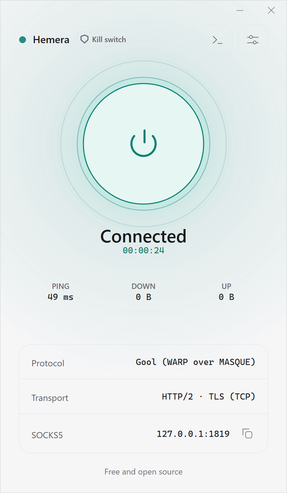
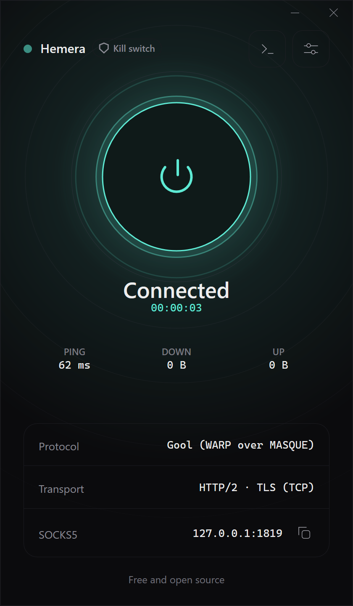

# Hemera

<p align="center">
  
</p>

<h3 align="center">Pure C++26 Native Implementation of Aether Censorship-Circumvention Engine & Desktop Application</h3>

<p align="center">
  A self-contained, high-performance native Windows port of the <a href="https://github.com/CluvexStudio/Aether"><b>Aether</b></a> circumvention engine.<br>
  Engineered from the ground up in modern <b>ISO C++26</b> with an integrated native network stack, <b>Direct2D hardware acceleration</b>, and zero external runtimes.
</p>

<p align="center">
  <a href="https://github.com/ramin-mahmoodi/Hemera/releases"></a>
  <a href="LICENSE"></a>
  
  
  
  
  <a href="https://github.com/ramin-mahmoodi/Hemera/actions"></a>
</p>

<p align="center">
  <b>English</b> · <a href="README_fa.md"><b>فارسی</b></a>
</p>

---

<p align="center">
  &nbsp;&nbsp;&nbsp;&nbsp;
  
</p>

## Overview

**Hemera** is a pure native C++26 implementation and standalone Windows application for [**Aether**](https://github.com/CluvexStudio/Aether) — an advanced censorship-circumvention tunnel architecture engineered for heavily restricted, adversarial networks where Deep Packet Inspection (DPI), SNI filtering, and protocol fingerprinting are prevalent.

Hemera is **not merely a graphical wrapper or frontend**. The entire network engine, protocol implementations, and user interface are ported and unified into a single, cohesive C++26 codebase:
- **No Go / Rust runtime dependencies:** Eliminates secondary daemon processes, heavy IPC serialization overhead, and garbage collection pauses.
- **No Web / Electron runtimes:** Built with native Win32 APIs and hardware-accelerated **Direct2D & DirectWrite** rather than embedding Chromium, Node.js, or WebView2.
- **Ultra-low resource footprint:** Consumes **under 15 MB of RAM**, uses **0.0% idle CPU**, starts up instantaneously (< 300 ms), and delivers a single monolithic executable.

---

## ⚡ Architecture & Performance Comparison

| Metric | Hemera (Pure C++26 Native) | Typical Go/Rust Core + Webview | Typical Electron Clients |
| :--- | :---: | :---: | :---: |
| **Engine Architecture** | **Unified In-Process Native C++26 Core** | External CLI Process + IPC Bridge | Node.js Backend / Sidecar Daemon |
| **RAM Consumption** | **< 15 MB** | 70 – 160 MB | 200 – 450 MB |
| **Idle CPU Usage** | **0.0%** | 0.8 – 3.0% | 2.0 – 6.0% |
| **GUI Rendering** | **Direct2D & DirectWrite (GPU Native)** | WebView2 / WebKit DOM | Chromium GPU / Blink Engine |
| **Startup Time** | **< 300 ms (Instant)** | 1.5 – 3.0 s | 2.5 – 6.0 s |
| **Binary Delivery** | **Single Monolithic `.exe` (~12 MB)** | Multi-file Bundle + Web Assets | 100+ MB Framework Bundle |
| **Runtime Dependencies** | **None (Pure Win32 OS APIs)** | Microsoft WebView2 Runtime | Node.js + Embedded Chromium |

---

## Key Features

### 🧠 Native C++ NetStack & Core Engine Port
- **In-Process Protocol Engine:** Complete native port of the Aether tunnel protocols directly in modern C++26, eliminating subprocess pipes and socket overhead.
- **RFC 6298 Jacobson/Karn RTT Estimator:** Continuous round-trip time and variance tracking with adaptive RTO boundaries (100 ms – 10 s) to eliminate stalled connections on lossy, high-jitter networks.
- **RFC 6582 NewReno Fast Recovery:** Recovers gracefully from multiple dropped packets within a single flight window without stalling transmission pipelines.
- **Condition-Variable Signaling:** True event-driven I/O with zero thread-spinning or busy-waiting, ensuring 0% CPU consumption when idle.
- **Windows EcoQoS Awareness:** Automatically suppresses Windows 11 background power throttling so network throughput and timer precision stay consistent when minimized.

### 🛡️ Censorship-Resistant Protocol Stack
- **MASQUE (HTTP/3 & HTTP/2):** Encapsulates raw IP datagrams inside genuine QUIC and HTTP/2 TLS streams. Features ClientHello fragmentation to completely evade TLS SNI-based firewalls.
- **WireGuard Engine:** Lean, high-throughput UDP tunnel implementation.
- **WARP-in-WARP (`gool`):** Dual nested WireGuard hops discovered automatically or routed through custom endpoints for clean egress IPs.
- **MASQUE-in-MASQUE (`mim`):** Two chained MASQUE tunnels for maximum censorship resistance and exit country diversity.

### 🌐 System-Wide Routing & Proxy Management
- **Native Wintun L3 Driver:** High-performance virtual network adapter that captures and routes all OS traffic, completely preventing DNS leaks and UDP bypasses.
- **Seamless WinINet System Proxy:** Automatically configures Windows system proxy settings with instant atomic notification (`InternetSetOptionW`) without requiring browser restarts.
- **Fail-Safe Proxy Restoration:** Guarantees atomic restoration of original network proxy settings upon disconnect, normal exit, or system crash.

### 🔍 Multi-Tier Route Discovery & Validation
- **Discovery Budgets:** Turbo, Balanced, and Thorough search profiles balancing discovery latency against endpoint candidate depth.
- **Data-Plane Verification (Verified / Ironclad):** Validates candidate gateways through real end-to-end encrypted HTTP requests, ensuring dead routes are discarded before establishing user traffic.

### 🎛️ Windows Integration & Controls
- **System Tray:** Minimizes cleanly to the notification area with live state badges and right-click quick controls.
- **Windows Job Object:** Sandboxes helper processes to guarantee zero orphaned background tasks.
- **Diagnostic Logging:** Real-time timestamped diagnostic console with one-click clipboard export.

---

## Download

Prebuilt binaries are available on the [**Releases**](https://github.com/ramin-mahmoodi/Hemera/releases) page:

| Architecture | Package | Description |
| :--- | :--- | :--- |
| **Windows x64** | [`Hemera-v1.0.7-windows-x64.zip`](https://github.com/ramin-mahmoodi/Hemera/releases/latest) | For standard 64-bit Intel / AMD PCs |
| **Windows ARM64** | [`Hemera-v1.0.7-windows-arm64.zip`](https://github.com/ramin-mahmoodi/Hemera/releases/latest) | For Surface Pro, Snapdragon X Elite & ARM PCs |

> **No installation required.** Simply extract the zip archive and run `Hemera.exe`.

---

## Building from Source

### Prerequisites
- **Windows 10 / 11** (x64 or ARM64)
- **Visual Studio 2022** (v17.10 or newer) with the *Desktop development with C++* workload
- **CMake 3.25+**

### Build Steps

1. **Clone the repository:**
   ```bash
   git clone https://github.com/ramin-mahmoodi/Hemera.git
   cd Hemera
   ```

2. **Configure CMake:**
   ```cmd
   cmake -B build -DCMAKE_BUILD_TYPE=Release
   ```

3. **Build Hemera (Release):**
   ```cmd
   cmake --build build --config Release
   ```
   The compiled executable will be located at `build/Release/Hemera.exe`.

4. **Run Unit Tests (54 Test Suites):**
   ```cmd
   .\build\Release\test_runner.exe
   ```

---

## Project Structure

```
Hemera/
├── include/                 # Public engine headers & data contracts
├── src/                     # Win32 Direct2D GUI, engine coordinator & main entry
│   ├── gui.cpp              # Direct2D hardware-accelerated rendering engine
│   ├── engine.cpp           # Process orchestration & proxy manager
│   ├── sysproxy.cpp         # Windows registry proxy integration
│   └── main.cpp             # DPI awareness, EcoQoS & WinMain lifecycle
├── core/                    # C++ NetStack & protocol implementations
│   ├── src/                 # NetStack, MASQUE, WireGuard, DNS, ECH
│   └── vendor/              # Vendored dependencies (BoringSSL, nghttp2, ngtcp2, RE2)
├── tests/                   # 54 comprehensive unit test suites
├── docs/                    # Screenshots and documentation assets
├── scripts/                 # Build helper scripts & ARM64 vendor builders
├── CMakeLists.txt           # Modern CMake configuration
└── build.bat                # Quick build launcher
```

---

## Credits & Acknowledgements

- [**CluvexStudio/Aether**](https://github.com/CluvexStudio/Aether) — Original censorship-circumvention tunnel & protocol architecture.
- [**Wintun**](https://www.wintun.net/) — High-performance TUN driver for Windows.

---

## License

This project is licensed under the [**GNU Affero General Public License v3.0 (AGPL-3.0)**](LICENSE).
