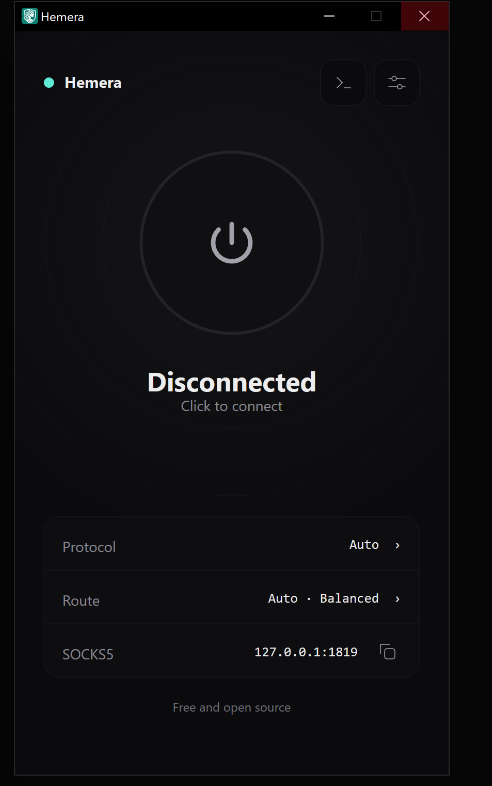

# هِمِرا (Hemera)

<p align="center">
  
</p>

<h3 align="center">کلاینت بومی (Native)، فوق‌سریع و سبک دورزدن فیلترینگ برای ویندوز</h3>

<p align="center">
  پیاده‌سازی کاملاً بومی و مدرن با <b>C++26</b> برای تونل‌های ضد فیلترینگ <a href="https://github.com/CluvexStudio/Aether"><b>Aether</b></a>.<br>
  طراحی‌شده از پایه با <b>شتاب‌دهنده گرافیکی سخت‌افزاری Direct2D</b>، بدون هرگونه وابستگی یا رانتایم وب و کمترین مصرف منابع.
</p>

<p align="center">
  <a href="https://github.com/ramin-mahmoodi/Hemera/releases"></a>
  <a href="LICENSE"></a>
  
  
  
  
  <a href="https://github.com/ramin-mahmoodi/Hemera/actions"></a>
</p>

<p align="center">
  <a href="README.md"><b>English</b></a> · <b>فارسی</b>
</p>

---

<p align="center">
  
</p>

## معرفی پروژه

**هِمِرا (Hemera)** پورت کاملاً بومی (Native) در ویندوز و کلاینت مستقل گرافیکی برای پروژه قدرتمند [**Aether**](https://github.com/CluvexStudio/Aether) است. اِتِر ابزاری پیشرفته برای عبور از فیلترینگ در شبکه‌های به شدت محدود و متخاصم است که در آن‌ها بازرسی عمیق بسته‌ها (DPI)، انگشت‌نگاری پروتکل‌ها و اختلال روی ترافیک UDP اعمال می‌شود.

برخلاف کلاینت‌های رایج دسکتاپ که بر پایه فریم‌ورک‌های سنگین وب (مانند Electron، WebView2، Qt یا WebKit) توسعه می‌یابند، **همرا** به طور کامل با استاندارد مدرن **ISO C++26** بازنویسی شده و رابط کاربری آن مستقیماً با **Windows Direct2D و DirectWrite** رندر می‌شود. حاصل این معماری، یک فایل اجرایی تک و مستقل با **مصرف رم کمتر از ۱۵ مگابایت**، **مصرف پردازنده ۰٪ در حالت بیکار** و انیمیشن‌های بی‌نهایت روان سخت‌افزاری با نرخ فریم **۶۰ تا ۱۲۰+ هرتز** است.

---

## ⚡ مقایسه عملکرد و معماری

| مشخصه | هِمِرا (Native C++26) | کلاینت‌های رایج مبتنی بر وب/Tauri | کلاینت‌های رایج Electron |
| :--- | :---: | :---: | :---: |
| **مصرف حافظه (RAM)** | **کمتر از ۱۵ مگابایت** | ۷۰ تا ۱۶۰ مگابایت | ۲۰۰ تا ۴۵۰ مگابایت |
| **مصرف پردازنده در حالت آماده (Idle CPU)** | **۰٫۰٪** | ۰٫۸ تا ۳٫۰٪ | ۲٫۰ تا ۶٫۰٪ |
| **موتور رندرینگ** | **Direct2D شتاب‌یافته با GPU** | WebView2 / WebKit DOM | Chromium GPU / Blink |
| **سرعت باز شدن برنامه (Startup Time)** | **کمتر از ۳۰۰ میلی‌ثانیه (آنی)** | ۱٫۵ تا ۳ ثانیه | ۲٫۵ تا ۶ ثانیه |
| **ساختار باینری** | **تک فایل `.exe` بومی (حدود ۱۲ مگابایت)** | باندل چند فایلی | بیش از ۱۰۰ مگابایت وابستگی |
| **وابستگی‌های خارجی** | **هیچ (مستقیماً Win32 API)** | رانتایم WebView2 مایکروسافت | رانتایم Node.js + کرومیوم |
| **نرخ فریم رندرینگ** | **انطباقی با نمایشگر (۶۰ / ۱۲۰ / ۱۴۴ هرتز)** | ثابت روی ۶۰ هرتز | ثابت روی ۶۰ هرتز |

---

## قابلیت‌ها و ویژگی‌ها

### 🚀 اتصال ساده با یک کلیک (Auto Mode)
- **بدون نیاز به پیکربندی دستی:** تنها با زدن دکمه اتصال، برنامه خودکار سرورهای فعال را شناسایی کرده، احراز هویت رمزنگاری‌شده را انجام داده و ترافیک را هدایت می‌کند.
- **اتصال مجدد فوق‌سریع (Quick Reconnect):** آخرین درگاه سالم ذخیره شده و پیش از اسکن کامل، ابتدا تست می‌شود؛ در نتیجه دفعات بعد در کمتر از ۲ ثانیه متصل می‌شوید.

### 🛡️ موتور پروتکل‌های پیشرفته
- **پروتکل MASQUE (نسخه‌های HTTP/3 و HTTP/2):** پکت‌های IP را داخل جریان‌های استاندارد و واقعی QUIC و TLS پنهان می‌کند. مجهز به خرد کردن بسته اول (ClientHello Fragmentation) برای عبور از فیلترهای حساس به SNI.
- **پروتکل WireGuard:** تونل فوق‌العاده سبک، سریع و مدرن بر بستر UDP.
- **مود WARP-in-WARP (`gool`):** دو تونل تو در توی وایرگارد برای تغییر آی‌پی خروجی به آی‌پی پاک و معتبر.
- **مود MASQUE-in-MASQUE (`mim`):** دو لایه ماسک تو در تو برای حداکثر پایداری در برابر DPI و تنوع کشورهای خروجی.

### 🌐 هدایت سراسری ترافیک ویندوز و پروکسی سیستم
- **کارت شبکه مجازی اختصاصی (Wintun TUN Driver):** امکان هدایت تمام ترافیک ویندوز از لایه ۳ کارت شبکه بدون نشت DNS یا عبور ترافیک UDP.
- **پروکسی هوشمند سیستم (SysProxy):** تنظیم خودکار رجیستری اینترنت ویندوز (WinINet) با اعمال آنی از طریق `InternetSetOptionW` بدون نیاز به بستن و باز کردن مرورگرها.
- **بازیابی امن تنظیمات پروکسی:** تنظیمات اصلی اینترنت شما پس از قطع اتصال، خروج عادی یا حتی در صورت کرش ناگهانی ویندوز به صورت تضمینی بازگردانده می‌شود.

### 🔍 اسکن هوشمند در سطوح مختلف
- **Turbo / Balanced / Thorough:** تنظیم عمق اسکن و پهنای باند جستجو متناسب با نیاز کاربر.
- **Verified / Ironclad:** بررسی اعتبار واقعی دیتاپلین. سرورها تنها پس از ارسال و دریافت یک درخواست واقعی رمزنگاری‌شده HTTP تأیید می‌شوند؛ در نتیجه هرگز به سرور مرده متصل نخواهید شد.

### 🧠 استک شبکه رویدادمحور و بدون قفل (NetStack)
- **تخمین پویای RTT بر اساس RFC 6298 (Jacobson/Karn):** تنظیم پیوسته تایم‌اوت‌های شبکه (بین ۱۰۰ میلی‌ثانیه تا ۱۰ ثانیه) برای حذف کامل سکته‌های ۱ ثانیه‌ای در مسیرهای پرنوسان.
- **بازیابی هوشمند پکت‌های گمشده با NewReno (RFC 6582):** جلوگیری از افت ناگهانی سرعت آپلود و ریکاوری پیوسته چند پکت گمشده در یک برست.
- **سیگنال‌دهی مبتنی بر Condition Variable:** حذف کامل مصرف بیهوده پردازنده و اسپین روی قفل‌های داخلی.
- **سازگاری هوشمند با ویندوز ۱۱ (EcoQoS-Aware):** غیرفعال‌سازی خودکار تقلیل کارایی ویندوز در پس‌زمینه تا کیفیت و سرعت شبکه حین مینی‌مایز در System Tray تضمین شود.

### 🎛️ هماهنگی با سینی سیستم و ویندوز
- **سینی سیستم (System Tray):** اجرای پس‌زمینه با نشانگر رنگی وضعیت اتصال و منوی کلیک‌راست سریع.
- **اشیاء کاری ویندوز (Job Objects):** محصور کردن پروسه‌های فرزند جهت اطمینان از بسته شدن کامل در صورت خروج.
- **کنسول لاگ زنده:** ثبت گزارش‌های عیب‌یابی با قابلیت کپی مستقیم در کلیپ‌بورد.

---

## دریافت و دانلود

فایل‌های آماده از بخش [**Releases (انتشارها)**](https://github.com/ramin-mahmoodi/Hemera/releases) قابل دریافت است:

| معماری پردازنده | فایل دانلودی | کاربرد |
| :--- | :--- | :--- |
| **ویندوز x64** | [`Hemera-v1.0.6-windows-x64.zip`](https://github.com/ramin-mahmoodi/Hemera/releases/latest) | مناسب تمام پردازنده‌های معمول ۶۴ بیتی اینتل و AMD |
| **ویندوز ARM64** | [`Hemera-v1.0.6-windows-arm64.zip`](https://github.com/ramin-mahmoodi/Hemera/releases/latest) | مناسب سرفیس‌پرو و پردازنده‌های اسنپ‌دراگون و ARM |

> **بدون نیاز به نصب.** فایل فشرده را استخراج کرده و `Hemera.exe` را اجرا کنید.

---

## راهنمای ساخت از سورس (Build)

### پیش‌نیازها
- **ویندوز ۱۰ یا ۱۱** (معماری x64 یا ARM64)
- **Visual Studio 2022** (نسخه ۱۷٫۱۰ به بالا) با ابزارهای *Desktop development with C++*
- **CMake نسخه ۳٫۲۵ به بالا**

### مراحل ساخت

۱. **دریافت سورس‌کد:**
   ```bash
   git clone https://github.com/ramin-mahmoodi/Hemera.git
   cd Hemera
   ```

۲. **پیکربندی CMake:**
   ```cmd
   cmake -B build -DCMAKE_BUILD_TYPE=Release
   ```

۳. **کامپایل پروژه در حالت Release:**
   ```cmd
   cmake --build build --config Release
   ```
   فایل اجرایی در مسیر `build/Release/Hemera.exe` ایجاد خواهد شد.

۴. **اجرای ۵۴ تست واحد:**
   ```cmd
   .\build\Release\test_runner.exe
   ```

---

## ساختار پوشه‌های پروژه

```
Hemera/
├── include/                 # هدرهای عمومی و ساختارهای داده
├── src/                     # کدهای رابط کاربری Direct2D و هماهنگ‌کننده موتور
│   ├── gui.cpp              # موتور رندرینگ سخت‌افزاری با Direct2D و DirectWrite
│   ├── engine.cpp           # مدیریت پروسه‌ها، لایف‌سایکل و وضعیت اتصال
│   ├── sysproxy.cpp         # تنظیم و بازیابی امن سیستم‌پروکسی ویندوز
│   └── main.cpp             # نقطه ورود WinMain، مدیریت DPI و EcoQoS
├── core/                    # هسته C++ شبکه و پیاده‌سازی پروتکل‌ها
│   ├── src/                 # کدهای NetStack، MASQUE، WireGuard، DNS، ECH
│   └── vendor/              # کتابخانه‌های داخلی (BoringSSL، nghttp2، ngtcp2، RE2)
├── tests/                   # ۵۴ سوئیت آزمون واحد جامع
├── docs/                    # تصاویر و اسکرین‌شات‌های مستندات
├── scripts/                 # اسکریپت‌های کمکی و بیلد ARM64
├── CMakeLists.txt           # پیکربندی مدرن ساخت پروژه با CMake
└── build.bat                # اسکریپت ساخت سریع
```

---

## قدردانی و منابع (Credits)

- [**CluvexStudio/Aether**](https://github.com/CluvexStudio/Aether) — طراحی پروتکل‌ها و هسته اصلی تونل‌های ضد فیلترینگ.
- [**MatinSenPai/Aether-GUI**](https://github.com/MatinSenPai/Aether-GUI) — الهام‌بخش رابط کاربری تمیز و تجربه کاربری دسکتاپ.
- [**Wintun**](https://www.wintun.net/) — درایور فوق‌العاده پرسرعت کارت شبکه مجازی ویندوز.

---

## لایسنس (License)

این پروژه تحت پروانه [**GNU Affero General Public License v3.0 (AGPL-3.0)**](LICENSE) منتشر شده است.
